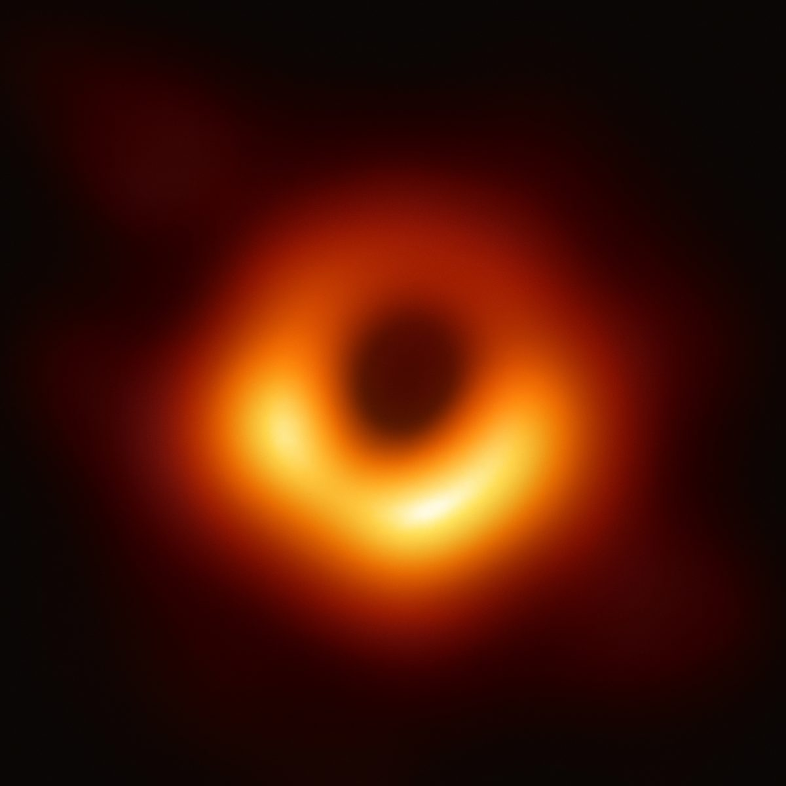
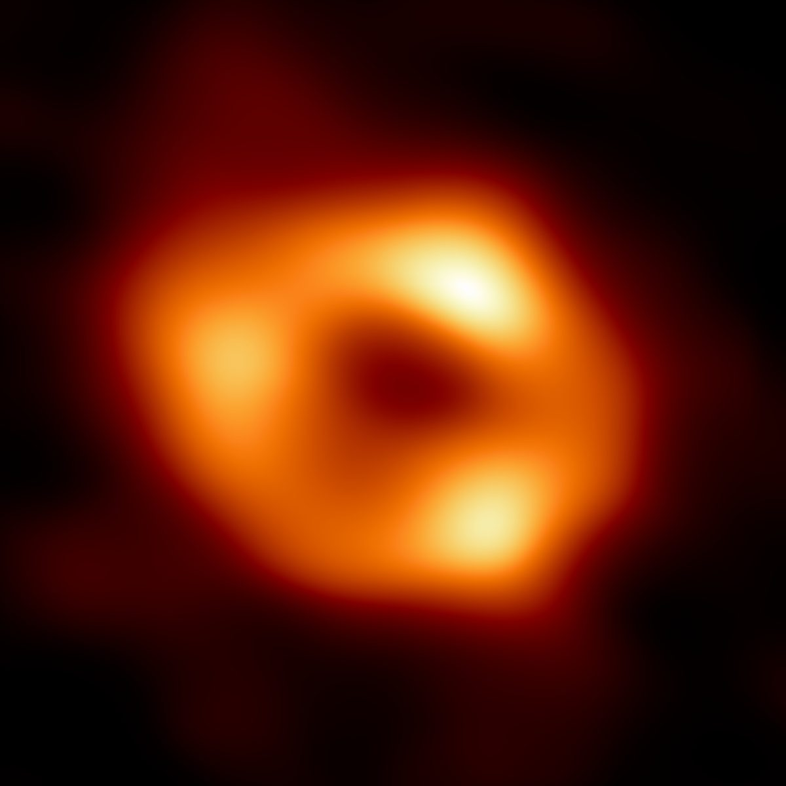

::: {.callout-note appearance="simple" icon=false}
**Disclaimer.** These notes have not been subjected to the usual scrutiny
reserved for formal publications. They may be distributed outside this class
only with the permission of the instructor.
:::



```{python}
#| label: disk-functions
#| include: false

# The course constants sheet, used by every figure on this page.
G, C, SIGMA = 6.6732e-8, 2.99792458e10, 5.6696e-5
H_PL, K_B = 6.6262e-27, 1.3806e-16
MP, SIGMA_T = 1.6726e-24, 6.6524e-25
MSUN, YR = 1.9891e33, 3.156e7
ERG_TO_EV = 6.242e11
ETA = 1 - np.sqrt(8 / 9)          # lecture 7: a non-spinning black hole


def disk_temperature(M, Mdot, r):
    """T(r) of @eq-disk-temp, cgs."""
    return (G * M * Mdot / (4 * np.pi * SIGMA * r**3)) ** 0.25


def eddington_mdot(M):
    """The accretion rate that gives the Eddington luminosity at efficiency ETA."""
    L_edd = 4 * np.pi * C * G * M * MP / SIGMA_T
    return L_edd / (ETA * C**2)
```

Last time we found the black holes in X-ray binaries by the gas they pull off
their companions, and saw that the gas cannot fall straight in: it has too
much angular momentum, so it goes into orbit and
spreads into a flat, spinning **accretion disk**. This lecture is about the
disk itself. Why does gas in a disk move inward at all, how hot does it get,
and what does its light look like? The answers take us right down to the
innermost stable orbit of lecture 2, where the gas moves at half the speed of
light, and there the light from the disk carries the marks of special and
general relativity at once. That is how we measure how fast a black hole
spins, and it is what the two black holes that have been photographed actually
look like.

## How to read this lecture

**These notes are the main reading for this lecture.** Read them alongside
Omer Blaes's *A Universe of Disks* [@blaes2004], a short article from
*Scientific American* that is in the Canvas Files under *Reading Material*. It
has no equations, and it is good on two things: why disks are everywhere,
from Saturn's rings to galaxies, and what makes the friction inside them. Read
it with the sections below in mind:

| section of these notes | the part of Blaes that goes with it |
|:---|:---|
| Gas in orbit | why disks form, and why the inner parts orbit faster |
| How hot is the disk? | the energy the gas gives up as it spirals in |
| What makes the friction | turbulence, and the magnetic instability that drives it |

The rest of the lecture, from *The light of a disk* on, draws on lectures 3,
5, 6 and 7, and the notes point back to each one where it is used.

## Gas in orbit

Gas in a disk is in orbit, and in orbit around a single central mass, each
parcel of gas obeys Kepler's and Newton's laws. Gravity supplies the force
that keeps it going in a circle, so for a parcel at radius $r$ moving at speed
$v$ around a mass $M$,

$$
\frac{v^2}{r} = \frac{GM}{r^2} ,
\qquad\text{so}\qquad
v = \sqrt{\frac{GM}{r}} .
$$ {#eq-kepler-v}

::: {.callout-tip .resolution collapse="true" title="Work out how much faster a parcel of gas moves after it spirals in to half its radius"}
From @eq-kepler-v, $v^2 \propto 1/r$, so the speeds at two radii are in the
ratio

$$
\frac{v_1}{v_2} = \left(\frac{r_2}{r_1}\right)^{1/2} .
$$

If $r_2 = 2 r_1$, then $v_1/v_2 = \sqrt 2$: the parcel is going $1.41$ times
as fast. **Gas on inner orbits moves faster.**
:::

That is the whole reason a disk shines. Neighboring rings of gas move at
different speeds, the inner one sliding past the outer one, and anything that
acts like friction between them turns some of the orbital motion into heat.
Hot gas glows. So: **differential motion, then friction, then heat, and
light.**

Friction does a second job, and it is the one that makes the gas move inward.
A parcel of gas in a circular orbit carries an angular momentum per gram of
$rv = \sqrt{GMr}$, which is *smaller* for a smaller orbit. So gas can only move
inward by getting rid of angular momentum, and friction is how it gets rid of
it: the faster inner ring drags the slower outer ring forward and is dragged
back by it in turn. The inner gas loses angular momentum and sinks; the outer
gas gains it and moves out. **Mass goes in and angular momentum goes out**,
and the disk spreads.

How much energy comes out is a question lecture 7 already answered. A gram of
gas in a circular orbit at radius $r$ has given up $GM/2r$ of energy compared
with gas at rest far away, half of the gravitational potential energy it has
fallen through; the other half went into its orbital motion. By the time it
reaches the innermost stable circular orbit, the ISCO, a non-spinning black
hole has turned 5.7% of the gas's rest mass energy into light, and a maximally
spinning one 42%. This lecture asks *where* in the disk that energy comes out,
and in what form.

::: {.content-visible when-format="html"}

### Exercises {#sec-exercises-orbit}

1. Gas orbits a $10\,M_\odot$ black hole at the ISCO of a non-spinning black
   hole, three Schwarzschild radii out. Use @eq-kepler-v to find its orbital
   speed as a fraction of the speed of light, and the time it takes to go
   once around.

   ::: {.callout-note .help-answer collapse="true" title="Answer"}
   At $r = 3\,r_S = 6GM/c^2$, @eq-kepler-v gives $v = c/\sqrt 6 = 0.41\,c$.
   The radius is $88.6\ \mathrm{km}$, and one orbit takes $4.5$ milliseconds.
   (General relativity says the gas is moving at exactly $0.5\,c$ there, as
   measured by someone hovering at that radius; we use that number in the
   section on iron lines.)
   :::

2. A gram of gas joins the disk around a black hole at 1000 Schwarzschild
   radii and works its way in to the ISCO at 3. What fraction of its angular
   momentum must it get rid of on the way?

   ::: {.callout-tip .help-hint collapse="true" title="Hint, and the answer"}
   The angular momentum per gram of a circular orbit is $rv$, and @eq-kepler-v
   gives $v$. Take the ratio at the two radii; the mass of the black hole
   cancels.

   The ratio is $\sqrt{1000/3} = 18$, so the gas keeps only 1/18 of what it
   started with: **it must get rid of about 95% of its angular momentum.**
   :::

3. If there were no friction at all between neighboring rings of gas in a
   disk, what would the disk do? Would it shine?

:::

## How hot is the disk?

::: {.panel-tabset .tracks}

### Physical intuition

Picture the disk as a set of thin rings, one inside the next. Gas is
constantly moving from each ring to the one inside it, and every time it does,
it gives up a little orbital energy as heat. In a steady disk the same amount
of gas passes through every ring each second, which is the **accretion rate**
$\dot M$.

**The inner rings are hotter, for two reasons that work together.** Gas moving
one step inward gives up more energy close to the black hole than far away,
because the gravitational pull is stronger there, and the inner rings are
smaller, so they have less surface to radiate that energy from. A ring that
has more energy to get rid of and less area to do it with must be hotter. Each
ring glows as a blackbody at its own temperature, so the inner edge of the
disk is the hottest and bluest part, and the temperature falls steadily
outward.

**A bigger black hole has a cooler disk.** That is not what you might guess,
since a bigger black hole has a bigger disk that gives off more light. But the
disk of a bigger black hole is bigger in proportion, and its area grows faster
than its luminosity does, so each square centimeter of it radiates less and is
cooler. That is why the disks in X-ray binaries shine in X-rays while the far
more powerful disks around the supermassive black holes in the centers of
galaxies shine mostly in ultraviolet light.

### Mathematical explanation

Consider a particle of mass $m$ in orbit around a central object (star, white
dwarf, neutron star, black hole, whatever) of mass $M$. It starts at an orbit
with radius $r_2$ and ends in an orbit with a smaller radius $r_1$. If the
orbits were not circular to begin with, they would circularize very quickly,
so we consider only circular orbits (but remember that the orbital energy
depends only on the semimajor axis).

How does it lose energy? From friction, due to shear forces. We assume that
all of the energy lost goes into heating the gas up, which is a pretty good
assumption: friction likes to heat things up. So all we need to do is
calculate the energy at $r_2$ and at $r_1$ and take the difference,

$$
\Delta E = E(r_2) - E(r_1) .
$$

Recall that the energy of a bound circular orbit is

$$
E = - \frac{G M m}{2r} ,
$$

and then the change in energy is

$$
\Delta E = - \frac{G M m}{2 r_2} - \left(-\frac{G M m}{2 r_1}\right)
         = G M m \left(\frac{1}{2 r_1} - \frac{1}{2 r_2}\right) .
$$

Setting $\Delta r \equiv r_2 - r_1$, small compared with $r_1$, and doing
enough algebra, you can get to

$$
\Delta E \approx \frac{G M m}{2 r_1^2}\, \Delta r .
$$ {#eq-ring-energy}

If we were doing this with calculus, we would take the limit as
$\Delta r \to dr$, but we can do fine with just algebra here.

This process is happening continuously, because we are pretending the disk is
large and steady. Call the mass that moves from $r_2$ to $r_1$ in a time
$\Delta t$ $\Delta M$, so $m = \Delta M$. If all of the energy it gives up is
turned into heat, the ring radiates as a blackbody in equilibrium, with a
luminosity

$$
L = \frac{\Delta E}{\Delta t} ,
\qquad\text{and thus}\qquad
\Delta E = L\, \Delta t .
$$

It is blackbody radiation, so from lecture 7, $L = \text{area} \times \sigma
T^4$. The area of a ring with small $\Delta r$ is $2\pi r_1 \Delta r$. Put the
above together to get

$$
\frac{G M\,\Delta M}{2 r_1^2}\, \Delta r
  = 2\pi r_1\, \Delta r\; \sigma T^4\, \Delta t ,
$$

and solve for $T^4$:

$$
T^4 = \frac{G M\, (\Delta M/\Delta t)}{4 \pi \sigma r_1^3} .
$$

Cool how those $\Delta r$'s went away, huh? Now we need to take the limit as
$\Delta t \to 0$. (Whoa, did I say we would not use calculus? Silly me.)
That makes $\Delta M/\Delta t \to dM/dt$. Since time derivatives are so common
in physics, we frequently write $dM/dt$ as $\dot M$ to save space, ink and
time. This is the **accretion rate**, the amount of mass per unit time moving
inward. Putting this all together, taking the fourth root, and writing $r$
instead of $r_1$, we get

$$
T(r) = \left( \frac{G M \dot M}{4 \pi \sigma r^3} \right)^{1/4} .
$$ {#eq-disk-temp}

This is the formula on your constants sheet. Check its units:
$G M \dot M$ is $\mathrm{cm^{3}\,g^{-1}\,s^{-2}} \times \mathrm{g} \times
\mathrm{g\,s^{-1}} = \mathrm{cm^{3}\,g\,s^{-3}}$, and $\sigma r^3$ is
$\mathrm{erg\,cm^{-2}\,K^{-4}\,s^{-1}} \times \mathrm{cm^{3}} =
\mathrm{cm^{3}\,g\,s^{-3}\,K^{-4}}$, since an erg is
$\mathrm{g\,cm^{2}\,s^{-2}}$. The ratio is $\mathrm{K^{4}}$, and its fourth
root is a temperature, as it must be.

### Numerical exploration

@fig-disk-temp plots @eq-disk-temp for two black holes that are both
non-spinning and both swallowing gas as fast as the Eddington limit of
lecture 8 allows: a $10\,M_\odot$ black hole in an X-ray binary, and a
$10^{8}\,M_\odot$ black hole in the center of a galaxy. Both curves fall as
$r^{-3/4}$, so they are parallel on these logarithmic axes. Measured in
Schwarzschild radii, the bigger black hole's disk is cooler everywhere, by a
factor of about 56. The colored bands show where a blackbody at each
temperature puts the peak of its light.

```{python}
#| label: fig-disk-temp
#| fig-cap: "The temperature of an accretion disk against distance from the black hole, from @eq-disk-temp, for a $10\\,M_\\odot$ and a $10^{8}\\,M_\\odot$ black hole, both non-spinning and both at the Eddington limit, with the disk starting at the ISCO, $3\\,r_S$. The distance is measured in Schwarzschild radii. The bands mark the part of the spectrum where a blackbody at each temperature peaks. The dashed line is a disk you can change in the next tab."
#| fig-alt: "A line chart on logarithmic axes. The horizontal axis is distance from the black hole in Schwarzschild radii, from 3 to 100,000. The vertical axis is temperature in kelvin, from 1,000 to 100 million. Four horizontal bands are labeled, from the top down, X-rays above about 300,000 kelvin, ultraviolet, visible light between about 3,900 and 7,600 kelvin, and infrared below. A solid blue line for a 10 solar mass black hole starts at about 16 million kelvin at 3 Schwarzschild radii, in the X-ray band, and falls in a straight line to about 6,000 kelvin at 100,000 Schwarzschild radii. A solid orange line for a 100 million solar mass black hole runs parallel to it and about 56 times lower, starting near 280,000 kelvin, just inside the ultraviolet band, and ending near 100 kelvin off the bottom of the chart. A dashed green line for a 10,000 solar mass black hole at a tenth of the Eddington limit runs parallel to both, between them."
#| fig-height: 4.2

# A disk to compare with the two real ones.
M_sun = 1e4            # the black hole's mass, in solar masses
f_edd = 0.1            # the accretion rate, as a fraction of the Eddington rate

x = np.logspace(np.log10(3), 5, 400)          # r / r_S, from the ISCO out


def temperature_curve(m_sun, frac):
    M = m_sun * MSUN
    r_s = 2 * G * M / C**2
    return disk_temperature(M, frac * eddington_mdot(M), x * r_s)


T_small = temperature_curve(10, 1.0)
T_big = temperature_curve(1e8, 1.0)
T_yours = temperature_curve(M_sun, f_edd)
print(f"your disk's inner edge: {T_yours[0]:.3g} K")
print(f"it glows brightest at: {0.289789 / T_yours[0] * 1e7:.3g} nm")

fig, ax = plt.subplots(figsize=(5.8, 4.2))
bands = [(2.9e5, 1e9, "X-rays"), (7.6e3, 2.9e5, "ultraviolet"),
         (3.9e3, 7.6e3, "visible"), (1, 3.9e3, "infrared")]
for k, (lo, hi, name) in enumerate(bands):
    ax.axhspan(lo, hi, color=GRID, alpha=1.0 if k % 2 == 0 else 0.0, lw=0,
               zorder=0)
    y = np.sqrt(max(lo, 1e3) * min(hi, 1e8))
    ax.text(1.6e5, y, name, ha="right", va="center", fontsize=9.5, color=INK2)

ax.plot(x, T_small, color=BLUE, lw=2, zorder=3)
ax.plot(x, T_big, color=ORANGE, lw=2, zorder=3)
ax.plot(x, T_yours, color=AQUA, lw=2, ls="--", zorder=3)
ax.text(5, 3.0e7, r"$10\,M_\odot$", color=BLUE, fontsize=10.5)
ax.text(3.6, 4.0e4, r"$10^{8}\,M_\odot$", color=ORANGE, fontsize=10.5)

ax.set_xscale("log")
ax.set_yscale("log")
ax.set_xlim(3, 1.7e5)
ax.set_ylim(1e3, 1e8)
ax.set_xlabel(r"distance from the black hole, $r/r_S$")
ax.set_ylabel(r"temperature $T$ (K)")
plt.show()
```

### Turn the knobs

::: {.content-visible when-format="pdf"}
Students have a live, editable version of this cell in the web notes —
remind them to try it.
:::

::: {.content-visible when-format="html"}

Same plot, but editable: change the mass of the black hole and its accretion
rate on the two marked lines, run the cell, and watch the dashed curve move.
The cell also prints the temperature of the inner edge and the wavelength at
which it glows brightest.

```{pyodide}
#| autorun: false

import numpy as np
import matplotlib.pyplot as plt

BLUE, ORANGE, AQUA = "#2a78d6", "#eb6834", "#1baf7a"
INK, INK2, MUTED, GRID = "#0b0b0b", "#52514e", "#898781", "#e1e0d9"

# The course constants sheet, used by every figure on this page.
G, C, SIGMA = 6.6732e-8, 2.99792458e10, 5.6696e-5
MP, SIGMA_T = 1.6726e-24, 6.6524e-25
MSUN = 1.9891e33
ETA = 1 - np.sqrt(8 / 9)          # lecture 7: a non-spinning black hole


def disk_temperature(M, Mdot, r):
    return (G * M * Mdot / (4 * np.pi * SIGMA * r**3)) ** 0.25


def eddington_mdot(M):
    L_edd = 4 * np.pi * C * G * M * MP / SIGMA_T
    return L_edd / (ETA * C**2)


# A disk to compare with the two real ones.
M_sun = 1e4            # the black hole's mass, in solar masses  # <- edit this
f_edd = 0.1            # the accretion rate, as a fraction of the Eddington rate  # <- edit this

x = np.logspace(np.log10(3), 5, 400)          # r / r_S, from the ISCO out


def temperature_curve(m_sun, frac):
    M = m_sun * MSUN
    r_s = 2 * G * M / C**2
    return disk_temperature(M, frac * eddington_mdot(M), x * r_s)


T_small = temperature_curve(10, 1.0)
T_big = temperature_curve(1e8, 1.0)
T_yours = temperature_curve(M_sun, f_edd)
print(f"your disk's inner edge: {T_yours[0]:.3g} K")
print(f"it glows brightest at: {0.289789 / T_yours[0] * 1e7:.3g} nm")

fig, ax = plt.subplots(figsize=(5.8, 4.2))
bands = [(2.9e5, 1e9, "X-rays"), (7.6e3, 2.9e5, "ultraviolet"),
         (3.9e3, 7.6e3, "visible"), (1, 3.9e3, "infrared")]
for k, (lo, hi, name) in enumerate(bands):
    ax.axhspan(lo, hi, color=GRID, alpha=1.0 if k % 2 == 0 else 0.0, lw=0,
               zorder=0)
    y = np.sqrt(max(lo, 1e3) * min(hi, 1e8))
    ax.text(1.6e5, y, name, ha="right", va="center", fontsize=9.5, color=INK2)

ax.plot(x, T_small, color=BLUE, lw=2, zorder=3)
ax.plot(x, T_big, color=ORANGE, lw=2, zorder=3)
ax.plot(x, T_yours, color=AQUA, lw=2, ls="--", zorder=3)
ax.text(5, 3.0e7, r"$10\,M_\odot$", color=BLUE, fontsize=10.5)
ax.text(3.6, 4.0e4, r"$10^{8}\,M_\odot$", color=ORANGE, fontsize=10.5)

ax.set_xscale("log")
ax.set_yscale("log")
ax.set_xlim(3, 1.7e5)
ax.set_ylim(1e3, 1e8)
ax.set_xlabel(r"distance from the black hole, $r/r_S$")
ax.set_ylabel(r"temperature $T$ (K)")
plt.show()
```
:::

:::

::: {.content-visible when-format="pdf"}

:::

**Notice a couple of things about @eq-disk-temp.** If we compare two disks at
the same physical radius, say $r = 1\ \mathrm{AU}$, then $T \propto M^{1/4}$:
the heavier black hole has the hotter disk. But it does not make sense to
compare a disk around a $10\,M_\odot$ black hole with one around a
$10^{6}\,M_\odot$ black hole at the same physical radius. We should compare
them at the same number of Schwarzschild radii, so write $r = n\,r_S$. It also
does not make sense to compare accretion rates at a fixed number of grams per
second. There is a maximum accretion rate, the one that gives the Eddington
luminosity of lecture 8, and it is proportional to $M$, so we should compare
them at the same fraction of that maximum, which makes $\dot M \propto M$. Put
$r \propto M$ and $\dot M \propto M$ into @eq-disk-temp, and

$$
T \propto \left( \frac{M \cdot M}{M^3} \right)^{1/4} = M^{-1/4} .
$$ {#eq-temp-scaling}

**Smaller black holes have hotter disks** (at a given radius, measured in
Schwarzschild radii). Ten million times the mass makes the disk
$10^{7/4} = 56$ times cooler, which is the gap between the two curves
of @fig-disk-temp.

::: {.callout-note .worked-example collapse="true" title="Worked example: the inner edge of an X-ray binary's disk"}
**The question.** A non-spinning black hole of $10\,M_\odot$ in an X-ray
binary is shining at its Eddington luminosity. How hot is its accretion disk
at the ISCO, and what kind of light does the gas there give off?

First the accretion rate. From lecture 8, the Eddington luminosity is
$1.26 \times 10^{38}\ \mathrm{erg\,s^{-1}}$ for each solar mass, so
$L = 1.26 \times 10^{39}\ \mathrm{erg\,s^{-1}}$. From lecture 7,
$L = \eta \dot M c^2$ with $\eta = 0.057$ for a non-spinning black hole, so

$$
\begin{aligned}
\dot M = \frac{L}{\eta c^2}
  &= \frac{1.26 \times 10^{39}\ \mathrm{erg\,s^{-1}}}
          {0.057 \times \left(3.00 \times 10^{10}\ \mathrm{cm\,s^{-1}}\right)^2}
     \\[0.8em]
  &= 2.45 \times 10^{19}\ \mathrm{g\,s^{-1}} ,
\end{aligned}
$$

where an erg is $\mathrm{g\,cm^{2}\,s^{-2}}$, so the units are
$\mathrm{g\,cm^{2}\,s^{-3}} / \mathrm{cm^{2}\,s^{-2}} = \mathrm{g\,s^{-1}}$.
That is about $4 \times 10^{-7}\,M_\odot$ a year.

Next the radius. The Schwarzschild radius of a $10\,M_\odot$ black hole is
$29.5\ \mathrm{km}$, and the ISCO is three times that:

$$
r = 3 \times 29.5\ \mathrm{km} \times \frac{10^{5}\ \mathrm{cm}}{1\ \mathrm{km}}
  = 8.86 \times 10^{6}\ \mathrm{cm} .
$$

Now substitute into the fourth power of @eq-disk-temp,
$T^4 = GM\dot M / 4\pi\sigma r^3$, with the units attached. The top and the
bottom are

$$
\begin{aligned}
G M \dot M &= 6.6732 \times 10^{-8}\ \mathrm{cm^{3}\,g^{-1}\,s^{-2}}
              \times 1.989 \times 10^{34}\ \mathrm{g} \\[0.8em]
           &\quad \times 2.45 \times 10^{19}\ \mathrm{g\,s^{-1}} , \\[0.8em]
4\pi\sigma r^3 &= 4\pi \times 5.67 \times 10^{-5}\ \mathrm{g\,s^{-3}\,K^{-4}}
                  \\[0.8em]
           &\quad \times \left(8.86 \times 10^{6}\ \mathrm{cm}\right)^3 ,
\end{aligned}
$$

where $\sigma$'s units, $\mathrm{erg\,cm^{-2}\,K^{-4}\,s^{-1}}$, have been
written out as $\mathrm{g\,s^{-3}\,K^{-4}}$. On top,
$\mathrm{cm^{3}\,g^{-1}\,s^{-2}} \times \mathrm{g} \times \mathrm{g\,s^{-1}} =
\mathrm{cm^{3}\,g\,s^{-3}}$; on the bottom,
$\mathrm{g\,s^{-3}\,K^{-4}} \times \mathrm{cm^{3}}$. Everything cancels except
$\mathrm{K^{4}}$. *Do the units make sense?* We are computing the fourth power
of a temperature, so yes. Now the numbers: the top is
$3.25 \times 10^{46}$ and the bottom $4.96 \times 10^{17}$, so

$$
T^4 = 6.55 \times 10^{28}\ \mathrm{K^{4}} ,
\qquad
T = 1.6 \times 10^{7}\ \mathrm{K} .
$$

**Sixteen million kelvin.** Lecture 7's $\lambda_{\max} T = 0.29\
\mathrm{cm\,K}$ puts the peak of its light at

$$
\lambda_{\max} = \frac{0.29\ \mathrm{cm\,K}}{1.6 \times 10^{7}\ \mathrm{K}}
  \times \frac{10^{7}\ \mathrm{nm}}{1\ \mathrm{cm}}
  = 0.18\ \mathrm{nm} ,
$$

which is **X-rays**. The typical photon energy $kT$ is $1.4\ \mathrm{keV}$,
the energy scale of lecture 8's X-ray sources.
:::

::: {.callout-warning title="A caveat: this is the simplest version of a disk"}
@eq-disk-temp is right in how the temperature scales, with $r^{-3/4}$ and
$M^{-1/4}$, and that is what this course uses it for. It is not the last word
on the numbers, for two reasons. A disk has two faces, so each ring has twice
the area we gave it to radiate from. And the friction that carries angular
momentum outward carries energy outward with it, so a ring radiates not only
the energy of the gas passing through it but some of the energy released
farther in. The careful version of this calculation, by Shakura and Sunyaev
[-@shakura1973], gives

$$
T(r)^4 = \frac{3 G M \dot M}{8 \pi \sigma r^3}
         \left[ 1 - \left( \frac{r_{\mathrm{in}}}{r} \right)^{1/2} \right] ,
$$

where $r_{\mathrm{in}}$ is the inner edge of the disk. Far from the inner
edge, the bracket is close to 1 and the temperature is 11% higher than
@eq-disk-temp gives. Near the inner edge, the bracket goes to zero: the hottest
ring is a little way out, at $1.36\,r_{\mathrm{in}}$, and it is about half as
hot as @eq-disk-temp says the inner edge is.
:::

::: {.content-visible when-format="html"}

### Exercises {#sec-exercises-hot}

1. Use @eq-temp-scaling to find the temperature at the ISCO of a disk around a
   non-spinning $10^{8}\,M_\odot$ black hole at its Eddington luminosity,
   starting from the worked example. Where in the spectrum does it glow
   brightest?

   ::: {.callout-note .help-answer collapse="true" title="Answer"}
   It is $1.6 \times 10^{7}\ \mathrm{K} / 10^{7/4} = 2.8 \times 10^{5}\ \mathrm{K}$,
   which peaks at $10\ \mathrm{nm}$: far ultraviolet, right at the edge of the
   X-rays.
   :::

2. A $1.4\,M_\odot$ neutron star of radius $12\ \mathrm{km}$ is fed at
   $10^{-9}\,M_\odot\,\mathrm{yr^{-1}}$, as in lecture 15, through a disk that
   reaches all the way down to its surface. What is the temperature of the
   disk at the surface of the star, and what is $kT$ in keV?

   ::: {.callout-note .help-answer collapse="true" title="Answer"}
   $9.9 \times 10^{6}\ \mathrm{K}$, peaking at $0.29\ \mathrm{nm}$, with
   $kT = 0.85\ \mathrm{keV}$: X-rays again.
   :::

3. How far from the $10\,M_\odot$ black hole of the worked example is the disk
   at $6000\ \mathrm{K}$, the temperature of the Sun's surface? Give the
   answer in Schwarzschild radii and in solar radii.

   ::: {.callout-tip .help-hint collapse="true" title="Hint, and the answer"}
   Solve @eq-disk-temp for $r$: $r = (G M \dot M / 4\pi\sigma T^4)^{1/3}$, and
   use the same $\dot M$ as the worked example.

   At $3.3 \times 10^{11}\ \mathrm{cm}$, which is $110{,}000\,r_S$ or
   $4.7\,R_\odot$. That is the size of a fair-sized star, and it is why the
   visible light of an X-ray binary comes from the outer disk and the
   companion, not from anywhere near the black hole.
   :::

4. Is there any black hole whose disk, at the ISCO and at the Eddington limit,
   glows brightest in visible light? Use @eq-temp-scaling, or try it in *Turn
   the knobs*.

   ::: {.callout-note .help-answer collapse="true" title="Answer"}
   To bring $1.6 \times 10^{7}\ \mathrm{K}$ down to about $7000\ \mathrm{K}$
   takes a factor of $2300$ in temperature, so $2300^4 = 3 \times 10^{13}$ in
   mass: about $3 \times 10^{14}\,M_\odot$. The heaviest black holes known
   are tens of thousands of times lighter than that. **No: the inner edge of
   every black hole's disk is hotter than visible light.**
   :::

5. Using the exact difference form of the energy,
   $\Delta E = GM\Delta M\,(1/2r_1 - 1/2r_2)$, add up the luminosity of every
   ring of a disk from an inner radius $r_{\mathrm{in}}$ out to a very large
   radius. Show that the whole disk gives off $L = GM\dot M/2r_{\mathrm{in}}$,
   which is the accretion luminosity of lecture 7.

   ::: {.callout-tip .help-hint collapse="true" title="Hint"}
   Write out the sum for three neighboring rings, from $r_4$ to $r_3$, $r_3$ to
   $r_2$, and $r_2$ to $r_1$, and look at which terms cancel.
   :::

:::

## The light of a disk

In one line: **each ring in an accretion disk radiates
as a blackbody, and each ring is a different color.** So the spectrum of the
whole disk is not a blackbody. It is a sum of blackbodies, one per ring, from
the hot inner edge out to the cool outer edge, which is why it is called a
**multicolor disk**.

Remember from lecture 7 that blackbody curves are nested: a hotter blackbody
is brighter at every wavelength. So at the highest photon energies, only the
hottest rings near the inner edge contribute, and the disk's spectrum falls
off there exactly as the inner edge's blackbody does. At lower energies, every
ring that is hot enough contributes, and the spectrum is much broader than
any one blackbody.

```{python}
#| label: fig-disk-spectrum
#| fig-cap: "The spectrum of the disk around a $10\\,M_\\odot$ black hole at its Eddington luminosity (solid), made by adding up a blackbody for every ring from the ISCO out to $10^{5}\\,r_S$, with the temperature of each from @eq-disk-temp. The power is plotted as $\\nu L_\\nu$, the luminosity per logarithmic interval of frequency, against photon energy. The dashed curves are the blackbodies of three single rings, at 1, 10 and 100 times the radius of the inner edge. Over most of its range the disk's spectrum rises as $\\nu^{4/3}$, much more slowly than any blackbody."
#| fig-alt: "A line chart on logarithmic axes. The horizontal axis is photon energy, from 1 electron volt to 30,000 electron volts, with bands labeled visible, ultraviolet and X-rays from left to right. The vertical axis is power per logarithmic interval of frequency, in erg per second, from 10 to the 33 to 10 to the 40. A solid blue curve, the whole disk, curves up from the lower left and then rises in a straight line with a gentle slope, marked nu to the four thirds by a short black line beneath it, peaks near 3,000 electron volts at about 10 to the 39, and drops steeply above that. Three dashed gray curves, single rings at 1, 10 and 100 times the inner radius, are humps lying under the blue curve and peaking at about 5,400, 960 and 170 electron volts. Each hump is much narrower than the blue curve, and the blue curve's steep high-energy edge falls off alongside the hottest hump."
#| fig-height: 4.2

M = 10 * MSUN
Mdot = eddington_mdot(M)
r_s = 2 * G * M / C**2
r_in = 3 * r_s

E_ev = np.logspace(0, np.log10(3e4), 400)      # photon energy, eV
nu = E_ev / ERG_TO_EV / H_PL


def ring_nuLnu(T, area):
    """nu L_nu of one face of a ring of the given area, as a blackbody."""
    B_nu = 2 * H_PL * nu**3 / C**2 / np.expm1(np.minimum(H_PL * nu / (K_B * T), 700))
    return nu * np.pi * B_nu * area


r_edges = np.logspace(np.log10(r_in), np.log10(1e5 * r_s), 801)
r_mid = np.sqrt(r_edges[1:] * r_edges[:-1])
area = np.pi * (r_edges[1:]**2 - r_edges[:-1]**2)
T_ring = disk_temperature(M, Mdot, r_mid)
disk = sum(ring_nuLnu(T, a) for T, a in zip(T_ring, area))

fig, ax = plt.subplots(figsize=(5.8, 4.2))
for lo, hi, name, k in [(1.65, 3.26, "visible", 0), (3.26, 124, "ultraviolet", 1),
                        (124, 3e4, "X-rays", 0)]:
    ax.axvspan(lo, hi, color=GRID, alpha=1.0 if k == 0 else 0.0, lw=0, zorder=0)
    ax.text(np.sqrt(lo * hi), 3e39, name, ha="center", fontsize=9.5, color=INK2)

for n in [1, 10, 100]:
    # One ring at n times the inner radius, about a fifth of its radius wide,
    # so that its hump sits under the whole disk and the shapes compare.
    r = n * r_in
    T = disk_temperature(M, Mdot, r)
    ax.plot(E_ev, ring_nuLnu(T, 0.4 * np.pi * r * r), color=MUTED, lw=1.2,
            ls="--", zorder=2)

ax.plot(E_ev, disk, color=BLUE, lw=2.2, zorder=3)
x0 = 20
y0 = 0.3 * np.interp(x0, E_ev, disk)
ax.plot([x0, 10 * x0], [y0, y0 * 10**(4 / 3)], color=INK, lw=1, zorder=4)
ax.text(4 * x0, 0.45 * y0 * 4**(4 / 3), r"$\nu^{4/3}$", fontsize=11, color=INK,
        ha="left", va="top")

ax.set_xscale("log")
ax.set_yscale("log")
ax.set_xlim(1, 3e4)
ax.set_ylim(1e33, 1e40)
ax.set_xlabel(r"photon energy $h\nu$ (eV)")
ax.set_ylabel(r"$\nu L_\nu$ (erg s$^{-1}$)")
plt.show()
```

Where does the $\nu^{4/3}$ come from? At a given frequency, the light comes
mostly from the rings whose blackbodies peak there, so count how much
luminosity sits in rings at each temperature. A ring of radius $r$ and width
proportional to $r$ has an area proportional to $r^2$, and radiates
$r^2 \sigma T^4 \propto r^2 \cdot r^{-3} = r^{-1}$. From @eq-disk-temp, the
radius of the ring at temperature $T$ goes as $r \propto T^{-4/3}$, so its
luminosity goes as $T^{4/3}$. Each ring's light comes out near the frequency
$\nu \propto T$, so the luminosity per logarithmic interval of frequency is
$\nu L_\nu \propto \nu^{4/3}$. Seeing that slope in a real spectrum is one of
the signatures of a disk.

::: {.content-visible when-format="html"}

### Exercises {#sec-exercises-light}

1. In a typical X-ray binary, the X-rays come from the gas near the black hole
   and the visible light from the outer disk and the companion star. Explain,
   from @fig-disk-temp and @fig-disk-spectrum, why the visible light cannot
   come from near the black hole.

2. Two black holes, one of $10\,M_\odot$ and one of $10^{8}\,M_\odot$, both
   accrete at their Eddington limits. Which has the more luminous disk, and by
   how much? Which has the hotter disk, and by how much? Explain in a sentence
   how both can be true.

   ::: {.callout-note .help-answer collapse="true" title="Answer"}
   The $10^{8}\,M_\odot$ disk is $10^{7}$ times more luminous, because the
   Eddington luminosity is proportional to the mass, but $56$ times cooler.
   Its area is bigger by $(10^{7})^2 = 10^{14}$, so each square centimeter
   radiates $10^{7}$ times less, which is $10^{7/4} = 56$ times less in
   temperature.
   :::

:::

## What makes the friction

So far we have simply assumed that something acts like friction in the disk.
**What that something is, is still being researched.** The obvious candidate,
the ordinary viscosity of the gas from atoms bumping into one another, is far
too weak. Blaes [-@blaes2004] puts it at many orders of magnitude too small to
carry gas in as fast as the brightness of the disks says it is coming in.

The next candidate is **turbulence**. Turbulence develops naturally in fluids,
and the shear in a disk, with the inner parts rotating faster than the outer
parts, looks as if it should cause it. But a disk in Keplerian orbit is
stable against ordinary turbulence: the angular momentum per gram, $\sqrt{GMr}$,
grows outward, and that holds the flow steady. Computer simulations of disks
made of ordinary, unmagnetized gas show no turbulence developing, and so no
friction.

For decades the working answer was to give up on the mechanism. Shakura and
Sunyaev [-@shakura1973] wrote the unknown friction as one adjustable number,
called $\alpha$, and worked out what a disk would look like. Their disk
explains observations of accretion disks well, but it is *ad hoc*: it says how
much friction there must be, and not where it comes from.

**The answer now accepted is magnetism.** The gas in an accretion disk is hot
enough to be ionized, so it carries currents, and currents make magnetic
fields. A magnetic field line threading the gas acts like a spring that ties
together the parcels it passes through. In a disk that rotates faster inside
than out, that spring is unstable, and the instability, found by Balbus and
Hawley [-@balbus1991], is called the **magnetorotational instability**, or
MRI.

::: {.callout-tip .resolution collapse="true" title="How a spring between two orbits makes the gas fall in"}
Take two parcels of gas on neighboring orbits, joined by a magnetic field line
that acts like a weak spring.

1. The inner parcel orbits faster, so it pulls ahead and the spring between
   them stretches.
2. The stretched spring pulls back on the inner parcel and forward on the outer
   one. So the inner parcel **loses angular momentum** and the outer one
   **gains** it.
3. With less angular momentum, the inner parcel drops to a smaller orbit, and
   with more, the outer one rises to a bigger orbit.
4. But a smaller orbit is a *faster* orbit, so the inner parcel pulls even
   farther ahead, and the spring stretches more.
5. The stretched spring pulls harder, and the whole thing runs away. The
   result is turbulence, which carries angular momentum outward and lets the
   gas fall inward: the friction the disk needs.

It works only if the spring is weak: a strong one would simply hold the two
parcels together. So even a feeble magnetic field is enough to make a disk
turbulent.
:::

The same magnetic fields may do something else as well. Field lines that leave
the inner disk can carry ionized gas away along them, out of the plane of the
disk in two directions, as **jets**. How jets are launched is not settled,
and we come back to them in an upcoming lecture.

::: {.content-visible when-format="html"}

### Exercises {#sec-exercises-friction}

1. In the spring picture of the MRI, explain in your own words why losing
   angular momentum makes the inner parcel move *faster*, not slower.

2. Saturn's rings are a disk too, and in them the "molecules" are rocks that
   collide. Why is that kind of friction enough for Saturn's rings, but not
   for the disk around a black hole? (Blaes discusses this.)

:::

## Iron lines: relativity in the light of the disk

Lecture 6 showed that a disk around a black hole is brighter on the side
coming toward us, and lecture 5 that light climbing out of a gravitational
field is redshifted. Both effects are largest at the inner edge of the disk,
and there is a way to see both at once, in one line of one element.

The innermost part of the disk is lit from above by X-rays from a hot,
tenuous layer of gas called the **corona**. When those X-rays hit iron atoms
in the disk, the iron fluoresces: it gives off an X-ray of its own at a
single, sharp photon energy, $6.4\ \mathrm{keV}$ [@fabian1989]. This is the
**iron K$\alpha$ line**. Iron is common enough, and the line strong enough, to
stand out clearly in the spectrum of the disk.

A line that starts out sharp makes a good ruler for every shift that happens
to it on its way to us. @fig-iron-line builds the line up one effect at a
time, for a single ring of gas at the ISCO of a non-spinning black hole, seen
$30^\circ$ from face-on:

1. **The ordinary Doppler shift.** One side of the ring comes toward us and is
   shifted to higher energy; the other side goes away and is shifted to lower.
   Gas moving across our line of sight is not shifted at all. The line splits
   into two horns, symmetric about $6.4\ \mathrm{keV}$.
2. **Special relativity.** The side coming toward us is brighter, by the
   $\mathcal{D}^4$ of lecture 6, so the high-energy horn is taller. And moving
   clocks run slow, by the $\gamma$ of lecture 3, which shifts the whole line
   to lower energy, even the gas moving across our line of sight.
3. **General relativity.** The light has to climb out from near the black
   hole, which redshifts all of it, by the $\sqrt{1 - r_S/r}$ of lecture 5.

A real disk is many rings, the inner ones faster and deeper in. Adding them up
gives the last panel: a line with a sharp edge on the high-energy side and a
long **red wing** stretching down to the energy of light from the ISCO.

```{python}
#| label: fig-iron-line
#| fig-cap: "The iron K$\\alpha$ line, which is emitted at $6.4\\ \\mathrm{keV}$ (dotted line), as it would be seen from gas orbiting a non-spinning black hole $30^\\circ$ from face-on. The top three panels are a single ring at the ISCO, $3\\,r_S$, where the gas moves at $c/2$: with only the ordinary Doppler shift, then with the brightening and time dilation of special relativity, then with the gravitational redshift as well. The bottom panel adds up rings from the ISCO out to $50\\,r_S$, with the inner rings brighter. Each panel is scaled to its own peak. The calculation ignores the bending of light, which changes the details but not the shape."
#| fig-alt: "Four stacked panels sharing a horizontal axis of photon energy from 3 to 8.5 keV, with a dotted vertical line at 6.4 keV in each. Top panel, ordinary Doppler shift only: two equal sharp horns at about 4.8 and 8.0 keV with a shallow trough between them. Second panel, plus special relativity: the two horns move left to about 4.4 and 7.4 keV and the right horn is now much taller than the left. Third panel, plus gravitational redshift: the same shape shifted further left, with horns at about 3.6 and 6.0 keV, so the whole line now lies below 6.4 keV. Bottom panel, a whole disk: a single broad, lopsided line with a steep edge at about 6.7 keV, a little above 6.4, and a long tail stretching down to about 3.6 keV."
#| fig-height: 6.4

E0 = 6.4                       # keV, the line at rest
incl = np.radians(30)
phi = np.linspace(0, 2 * np.pi, 200001)
bins = np.linspace(3.0, 8.5, 551)
centers = 0.5 * (bins[1:] + bins[:-1])
kernel = np.exp(-0.5 * (np.arange(-15, 16) * 0.01 / 0.05)**2)


def line_profile(energies, weights):
    hist, _ = np.histogram(energies, bins=bins, weights=weights)
    smooth = np.convolve(hist, kernel / kernel.sum(), mode="same")
    return smooth / smooth.max()


def ring(x, effects):
    """Energies and weights for a ring at x = r c^2 / GM. effects: 0, 1, 2."""
    beta = np.sqrt(1 / (x - 2))            # local orbital speed, Schwarzschild
    v_r = -beta * np.sin(incl) * np.sin(phi)   # negative = toward us
    if effects == 0:
        g = 1 - v_r                        # low-speed Doppler, symmetric
        w = np.ones_like(phi)
    else:
        gamma = 1 / np.sqrt(1 - beta**2)
        g = 1 / ((1 + v_r) * gamma)
        if effects == 2:
            g = g * np.sqrt(1 - 2 / x)
        w = g**4
    return E0 * g, w


fig, axes = plt.subplots(4, 1, figsize=(5.8, 6.4), sharex=True)
titles = ["ordinary Doppler shift", "plus special relativity",
          "plus gravitational redshift", "a whole disk"]
for k, ax in enumerate(axes[:3]):
    E, w = ring(6.0, k)
    ax.fill_between(centers, line_profile(E, w), color=BLUE, alpha=0.25, lw=0)
    ax.plot(centers, line_profile(E, w), color=BLUE, lw=1.6)

E_all, w_all = [], []
for x in np.logspace(np.log10(6.0), np.log10(100.0), 60):
    E, w = ring(x, 2)
    E_all.append(E)
    w_all.append(w * x**-3 * x * x)   # emissivity r^-3, area r dr, dr ~ r dln r
prof = line_profile(np.concatenate(E_all), np.concatenate(w_all))
axes[3].fill_between(centers, prof, color=ORANGE, alpha=0.25, lw=0)
axes[3].plot(centers, prof, color=ORANGE, lw=1.6)

for ax, title in zip(axes, titles):
    ax.axvline(E0, color=MUTED, ls=":", lw=1.2)
    ax.set_ylim(0, 1.15)
    ax.set_yticks([])
    ax.text(0.015, 0.88, title, transform=ax.transAxes, fontsize=10,
            color=INK, va="top")
axes[-1].set_xlim(3.0, 8.5)
axes[-1].set_xlabel("photon energy (keV)")
fig.supylabel("line flux", fontsize=11, color=INK, x=0.06)
plt.show()
```

::: {.callout-note .worked-example collapse="true" title="Worked example: the iron line from the ISCO, seen face-on"}
**The question.** Gas orbits a non-spinning black hole at the ISCO, three
Schwarzschild radii out, and we see the disk face-on. At what energy does its
$6.4\ \mathrm{keV}$ iron line arrive?

Seen face-on, none of the gas is moving toward us or away from us, so there is
no ordinary Doppler shift and no brightening of one side. Two effects are
left, and both lower the energy.

**Time dilation.** General relativity says that the gas at the ISCO moves at
half the speed of light, as measured by someone hovering at that radius. From
lecture 3, its clocks run slow by

$$
\gamma = \frac{1}{\sqrt{1 - \beta^2}} = \frac{1}{\sqrt{1 - 1/4}}
       = \frac{2}{\sqrt 3} = 1.155 ,
$$

so the light leaves with its energy lowered by a factor $1/\gamma = 0.866$.
This is the constants sheet's $\lambda' = \lambda (1 + v_r/c) \gamma$ with
$v_r = 0$.

**Gravitational redshift.** From lecture 5, light climbing out from
$r = 3\,r_S$ arrives with its energy lowered by

$$
\sqrt{1 - \frac{r_S}{r}} = \sqrt{1 - \frac13} = \sqrt{\frac23} = 0.816 .
$$

Both factors are pure numbers, so the units of the energy pass straight
through. Multiply:

$$
E = 6.4\ \mathrm{keV} \times \sqrt{\frac23} \times \frac{\sqrt 3}{2}
  = 6.4\ \mathrm{keV} \times \frac{1}{\sqrt 2}
  = 4.5\ \mathrm{keV} .
$$

**The line arrives at 4.5 keV, 30% below where it started.** The two factors
combine into exactly $1/\sqrt 2$, which is no accident: for any circular orbit
around a non-spinning black hole, the product works out to
$\sqrt{1 - 3r_S/2r}$.
:::

**The red wing measures the spin.** The farthest the red wing can reach is set
by the innermost gas, the gas at the ISCO, and lecture 2 showed that the ISCO
moves inward as the black hole spins faster, from $3\,r_S$ at no spin to
$r_S/2$ at the maximum. Closer in, the gas moves faster and the light has
farther to climb, so a faster-spinning black hole has a longer red wing.
Fitting the shape of the line gives the radius of the ISCO, and so the spin.
The first broad iron line, reported in 1995 from the galaxy MCG–6–30–15, has
gas moving at about $100{,}000\ \mathrm{km\,s^{-1}}$ and most of the line
shifted to the red, and it comes from between three and ten Schwarzschild radii
from the black hole [@tanaka1995]. Many black holes have been measured this way
since, and many of them spin fast [@reynolds2021].

::: {.content-visible when-format="html"}

### Exercises {#sec-exercises-iron}

1. Repeat the worked example for gas orbiting at five Schwarzschild radii,
   where general relativity says it moves at $0.354\,c$. At what energy does
   the line arrive?

   ::: {.callout-note .help-answer collapse="true" title="Answer"}
   Here $1/\gamma = 0.935$ and $\sqrt{1 - 1/5} = 0.894$, so the line arrives at
   $6.4 \times 0.837 = 5.4\ \mathrm{keV}$. Check: $\sqrt{1 - 3/10} = 0.837$.
   :::

2. Now look at the ring at the ISCO edge-on, so that one side comes straight
   toward us at $c/2$ and the other goes straight away. Ignoring the bending of
   light, at what energies do the two sides' lines arrive? Which is brighter,
   and by how much?

   ::: {.callout-tip .help-hint collapse="true" title="Hint, and the answer"}
   Use lecture 6's Doppler factor,
   $\mathcal{D} = 1/[(1 + v_r/c)\gamma]$, with $v_r = \mp c/2$, then multiply
   by the gravitational factor from the worked example. Lecture 6's
   $F \propto \mathcal{D}^4$ gives the brightness.

   The approaching side arrives at $9.1\ \mathrm{keV}$ and the receding side
   at $3.0\ \mathrm{keV}$. The approaching side is brighter by
   $3^4 = 81$ times.
   :::

3. Explain why the lowest energy at which the line arrives tells us how fast
   the black hole spins, and why that measurement works for a black hole of
   any mass.

:::

## The Event Horizon Telescope

In lecture 6 we put together a prediction: a black hole surrounded by glowing
gas should look like **a ring of light, brighter on one side, around a dark
shadow** whose diameter is $\sqrt{27}\,r_S \approx 5.2\,r_S$. We also said we
would come back to the photographs once we had the physics to say what the
glowing gas is doing. Now we do. The bright side is the side of the disk
coming toward us, made brighter by the same $\mathcal{D}^4$ that tilts the
iron line.

The obstacle to testing the prediction was never the physics; it was the
angular size. The shadow is a few times $r_S$ across, and $r_S$ for even the
largest black holes is small compared with how far away they are. Only two
targets are within reach: M87\*, the black hole at the center of the galaxy
M87, which is enormous and far, and Sgr A\* at the center of our own Galaxy,
which is small and close.

The resolution of a telescope is set by the ratio of the wavelength to the
size of its aperture. Observing at $1.3\ \mathrm{mm}$ and asking for
$50\ \mu\text{as}$ requires an aperture of about $5{,}400\ \mathrm{km}$,
which is to say a telescope somewhat smaller than the Earth and far larger than
anything that can be built in one place. The Event Horizon Telescope solves
this by not building it in one place: radio dishes on several continents
observe at the same time, record the incoming radio waves against atomic
clocks, and are combined afterward into a single instrument with an aperture
equal to the longest distance between them. The Earth is
$12{,}700\ \mathrm{km}$ across, so there is a factor of two in hand, and not
much more than that. **This experiment is very nearly as large as an
experiment on this planet can be.**

::: {#fig-eht layout-ncol=2}

{#fig-eht-m87
fig-alt="A radio image of the black hole at the center of the galaxy M87. A
thick, fuzzy orange ring of light surrounds a dark circular center. The ring
is not uniform: its lower portion is distinctly brighter and whiter than the
rest, which fades to dim red at the top."}

{#fig-eht-sgra
fig-alt="A radio image of the black hole at the center of our own Galaxy. As
with M87, a fuzzy orange ring surrounds a darker center, but here the ring is
lumpier and the dark center is proportionally smaller. Three bright knots sit
around the ring rather than one continuous bright arc."}

The two black holes the Event Horizon Telescope has resolved, the only two
whose shadows have been imaged [@eht2019m87; @eht2022sgra]. Images by the
[EHT Collaboration](https://www.eso.org/public/images/eso1907a/), used under
[CC BY 4.0](https://creativecommons.org/licenses/by/4.0/); the M87\* image is
cropped from the original wide plate and both are resized.
:::

<!-- ATTRIBUTION IS A LICENSE CONDITION HERE, not a courtesy -- CC BY 4.0
     requires visible credit, so it lives in the caption and not in this
     comment. ESO's terms verified 2026-09-09 (lecture 6 session); the images
     were staged in for_me/lec16/media/ then.

     MODIFICATION MUST BE DECLARED, and it is, in the caption's last clause.
     m87-eht.jpg is a square crop of ESO's eso1907a (7416x4320) around the
     measured luminous region, then resized to 1200x1200. sgra-eht.jpg is
     eso2208-eht-mwa resized 4076 -> 1200, uncropped. Sources:
     https://www.eso.org/public/images/eso1907a/
     https://www.eso.org/public/images/eso2208-eht-mwa/ -->

Both are rings. Both are brighter on one side. Both surround a dark center.
And the sizes are right. M87\* has a mass of
$6.5 \times 10^{9}\,M_\odot$ and is $16.8\ \mathrm{Mpc}$ away, so the predicted
shadow is $39.7\ \mu\text{as}$ across, against a measured ring
$42 \pm 3\ \mu\text{as}$ across [@eht2019m87]. For Sgr A\*, at about
$4.0 \times 10^{6}\,M_\odot$ and the $8.0\ \mathrm{kpc}$ on your constants
sheet, the prediction is $51\ \mu\text{as}$ against a measured
$51.8 \pm 2.3$ [@eht2022sgra]. The mass of Sgr A\* was measured years earlier
by watching *stars* orbit it, a completely independent method that knows
nothing about light bending.

::: {.callout-tip .resolution collapse="true" title="Think about why Sgr A* looks bigger on the sky than M87* despite being far smaller"}
Sgr A\* is about **1600 times less massive** than M87\*, so its Schwarzschild
radius, and its shadow, is about 1600 times smaller.

It is also about **2100 times closer**.

Angular size is physical size divided by distance, so the two ratios fight,
and the distance wins: $1600/2100 \approx 0.77$, so M87\*'s shadow subtends
a little over three-quarters of what Sgr A\*'s does. The predicted numbers above bear that
out, at $39.7$ against $51\ \mu\text{as}$.

This is why there are exactly two targets and not more. Being the biggest is
not enough and being the nearest is not enough; a black hole has to win the
ratio.
:::

::: {.content-visible when-format="html"}

### Exercises {#sec-exercises-eht}

1. Confirm the shadow diameter quoted for M87\*. Take
   $M = 6.5 \times 10^{9}\,M_\odot$ and a distance of $16.8\ \mathrm{Mpc}$,
   compute $r_S$, multiply by $\sqrt{27}$ for the diameter of the shadow, and
   convert the angle to microarcseconds.

   ::: {.callout-tip .help-hint collapse="true" title="Hint, and the answer"}
   An angle in radians is the physical size divided by the distance, provided
   both are in the same units, which is what the conversion fraction is for.
   The constants sheet gives $1\ \mathrm{rad} = 206265''$, and a
   microarcsecond is $10^{-6}$ of an arcsecond.

   The Schwarzschild radius is $r_S = 1.92 \times 10^{15}\ \mathrm{cm}$, the shadow diameter
   $9.98 \times 10^{15}\ \mathrm{cm}$, distance
   $5.18 \times 10^{25}\ \mathrm{cm}$, angle
   $1.92 \times 10^{-10}\ \mathrm{rad} = 39.7\ \mu\text{as}$.
   :::

2. Repeat for Sgr A\*, at $4.0 \times 10^{6}\,M_\odot$ and
   $8.0\ \mathrm{kpc}$, and confirm that the smaller black hole really does
   subtend the larger angle.

3. The Event Horizon Telescope observes at $1.3\ \mathrm{mm}$. If it observed
   instead at $7\ \mathrm{mm}$, a much easier wavelength technically, how
   large would the array have to be to resolve M87\*'s shadow? Is that
   possible?

   ::: {.callout-note .help-answer collapse="true" title="Answer"}
   The aperture needed grows in proportion to the wavelength, by
   $7/1.3 = 5.4$, from about $5{,}400\ \mathrm{km}$ to about
   $29{,}000\ \mathrm{km}$. That is more than twice the diameter of the Earth,
   so it is not possible from the ground at all; it would need a dish in
   space.
   :::

4. A third black hole is proposed as a target. It is 10 times more massive
   than M87\* and 30 times farther away. Could the existing array resolve its
   shadow? No calculation of $r_S$ is needed.

:::

## If you want to go further

None of this section is needed for what comes before or after.

**Measuring spin.** Reynolds [-@reynolds2021] reviews the ways black hole spin
is measured: iron lines, as here; fitting the whole multicolor spectrum of the
disk, whose inner edge is set by the ISCO; and gravitational waves, from
lecture 10. The spins of black holes in X-ray binaries and in merging pairs
come out strikingly different.

**Where the iron line was first predicted.** Fabian and collaborators
[-@fabian1989] worked out the shape the line should have from a disk around a
black hole six years before Tanaka and collaborators saw it. A full
calculation also follows the bending of light, which @fig-iron-line leaves
out.

## Summary

| idea | result | why it matters |
|:---|:---|:---|
| Gas in orbit | $v = \sqrt{GM/r}$, so inner rings move faster | the shear between rings is what heats the disk |
| Moving inward | gas must lose angular momentum, and friction carries it outward | mass goes in, angular momentum goes out |
| Disk temperature | $T = (GM\dot M/4\pi\sigma r^3)^{1/4}$ | hottest at the inner edge, $T \propto r^{-3/4}$ |
| Scaling with mass | $T \propto M^{-1/4}$ at fixed $r/r_S$ and Eddington fraction | X-ray binaries glow in X-rays, supermassive black holes in the ultraviolet |
| The spectrum | a sum of blackbodies, $\nu L_\nu \propto \nu^{4/3}$ | a multicolor disk, not a single blackbody |
| The friction | magnetic fields, through the magnetorotational instability | ordinary viscosity is far too weak |
| Iron lines | Doppler horns, relativistic brightening, time dilation, gravitational redshift | the red wing reaches down to the ISCO, and so measures the spin |
| The EHT | a lopsided ring around a shadow $\sqrt{27}\,r_S$ across | the predicted picture, at the predicted size, for M87\* and Sgr A\* |

Gas falling onto a black hole spirals in through a disk, heats up as friction
carries its angular momentum away, and shines hottest at the inner edge, where
it moves at half the speed of light and its light carries the marks of both
relativities. From here the course moves from stars to galaxies, where the
black holes are millions of times heavier and their disks, by @eq-temp-scaling,
are cooler, brighter and far bigger.

:::: {.content-visible when-format="html"}
## References {.unnumbered}

::: {#refs}
:::
::::

::: {.content-visible when-format="pdf"}

```{=latex}
\clearpage
\tableofcontents
```
:::
